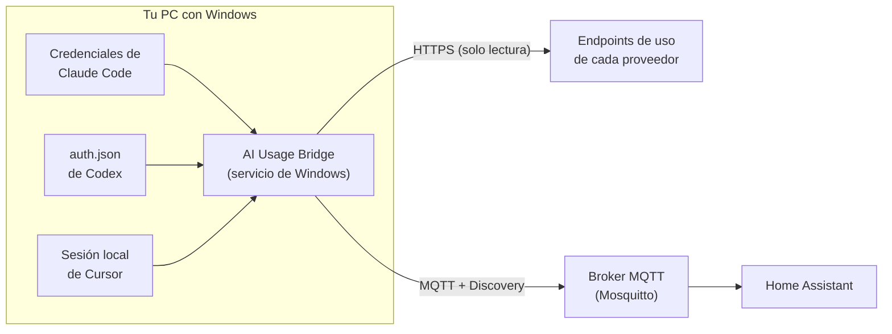

<div align="center">

# AI Usage Bridge

**Mirá cuánto te queda de Claude, ChatGPT/Codex y Cursor, directo en Home Assistant.**

[](https://github.com/The-AI-Software-Factory/ai-usage-bridge/actions/workflows/ci.yml)
[](https://github.com/The-AI-Software-Factory/ai-usage-bridge/releases/latest)
[](LICENSE)


[English](README.md) · [Español](README.es.md)

</div>

---

Si trabajás con varios agentes de IA, cada uno tiene sus propios límites: una ventana de 5 horas, un tope semanal, un presupuesto mensual incluido. Revisar tres dashboards antes de asignar la próxima tarea cansa rápido.

**AI Usage Bridge** es un pequeño servicio de Windows que lee esos números desde las herramientas de IA que ya tenés logueadas en tu PC y los publica en tu broker MQTT con **Home Assistant MQTT Discovery**. Los sensores aparecen solos en Home Assistant, junto con un sensor de **"mejor destino"** que te dice qué agente tiene más margen en este momento.

## Contenido

- [Servicios soportados](#servicios-soportados)
- [Cómo funciona](#cómo-funciona)
- [Requisitos](#requisitos)
- [Instalación](#instalación)
- [Qué ves en Home Assistant](#qué-ves-en-home-assistant)
- [Configuración](#configuración)
- [Actualizar](#actualizar)
- [Desinstalar](#desinstalar)
- [Solución de problemas](#solución-de-problemas)
- [Seguridad y privacidad](#seguridad-y-privacidad)
- [Aviso](#aviso)
- [Contribuir](#contribuir)
- [Compilar desde el código](#compilar-desde-el-código)
- [Licencia](#licencia)

## Servicios soportados

| Servicio | Qué informa | Sesión que reutiliza |
|---|---|---|
| **Claude** (Pro / Max) | Uso de 5 h y semanal, límites semanales por modelo, créditos extra, horarios de reset | Login de Claude Code |
| **ChatGPT / Codex** (planes de ChatGPT que incluyen Codex) | Uso de 5 h y semanal, horarios de reset, créditos, plan | Login de Codex con tu cuenta de ChatGPT |
| **Cursor** (planes individuales) | % de uso incluido, modelos de Cursor vs. otros, gasto on‑demand y su límite, fin del ciclo de facturación | Login de la app de escritorio de Cursor |

Podés habilitar los que quieras. Los límites de Claude son compartidos entre los chats de claude.ai y Claude Code, así que los números coinciden con **Configuración → Uso**. Lo mismo pasa con los límites de Codex que muestra la configuración de ChatGPT.

> [!NOTE]
> Ninguno de estos proveedores ofrece una API pública para el uso de las suscripciones. El bridge consulta los mismos endpoints internos que usan sus propios clientes y dashboards. Hoy funcionan, pero pueden cambiar sin aviso; ver [Aviso](#aviso).

## Cómo funciona



1. Cada pocos minutos, el servicio lee el token de sesión que cada herramienta ya guarda en disco. No hace falta volver a loguearse ni crear una API key.
2. Le pide a cada proveedor el uso actual. Solo lee: nunca manda prompts ni consume cuota.
3. Publica un estado JSON retenido por servicio, más un resumen, y anuncia todas las entidades por MQTT Discovery.
4. Si una consulta falla, se mantienen los últimos valores buenos y el sensor **Estado** explica el motivo. Cuando pasa la hora de reset, esa ventana baja a 0 % aunque todavía no haya una lectura nueva.

## Requisitos

- **Windows 10 u 11** (x64), con permisos de administrador para instalar el servicio. No hace falta instalar Python: viene incluido.
- **Un broker MQTT** accesible desde la PC, por ejemplo el add‑on Mosquitto de Home Assistant.
- **Home Assistant** con la [integración MQTT](https://www.home-assistant.io/integrations/mqtt/) configurada y discovery habilitado (viene así por defecto).
- Al menos una de las herramientas de IA instalada y **logueada en la misma PC**:
  - Claude: [Claude Code](https://docs.claude.com/en/docs/claude-code/overview), logueado con tu cuenta de Claude.ai (`claude` → `/login`).
  - Codex: [Codex CLI](https://github.com/openai/codex) o la app de Codex, logueado con ChatGPT (no con API key).
  - Cursor: la app de escritorio de [Cursor](https://cursor.com), con sesión iniciada.

## Instalación

### 1. Elegí el instalador

Cada [**versión**](https://github.com/The-AI-Software-Factory/ai-usage-bridge/releases/latest) trae tres paquetes equivalentes. Todos incluyen su propio Python, así que **no hace falta instalar nada más**.

| Archivo | Ideal para | Cómo pide los datos del broker MQTT |
|---|---|---|
| [**`AIUsageBridge-Setup.exe`**](https://github.com/The-AI-Software-Factory/ai-usage-bridge/releases/latest/download/AIUsageBridge-Setup.exe) | La mayoría de la gente | Una pantalla del asistente |
| [**`AIUsageBridge.msi`**](https://github.com/The-AI-Software-Factory/ai-usage-bridge/releases/latest/download/AIUsageBridge.msi) | Despliegues gestionados (Intune, GPO, SCCM) | Propiedades del MSI, o el configurador al terminar |
| [**`ai-usage-bridge.zip`**](https://github.com/The-AI-Software-Factory/ai-usage-bridge/releases/latest/download/ai-usage-bridge.zip) | Instalación portable o por script | Preguntas en consola (`install.cmd`) o parámetros |

Cada versión publica también `SHA256SUMS.txt` para verificar las descargas:

```powershell
Get-FileHash .\AIUsageBridge-Setup.exe -Algorithm SHA256
```

> [!NOTE]
> Los instaladores todavía no están firmados, así que Windows SmartScreen puede mostrar "Windows protegió tu PC". Elegí **Más información → Ejecutar de todas formas**, o compilalos vos mismo desde el código (ver [Compilar desde el código](#compilar-desde-el-código)).

### 2. Instalar

**Setup.exe:** ejecutalo, aceptá la licencia, ingresá host o IP del broker, puerto (por defecto `1883`), usuario y contraseña (vacíos si el broker es anónimo), elegí si querés [renovar automáticamente el token de Claude](#mantener-actualizados-los-datos-de-claude), y terminá.

**MSI:** ejecutalo y, en la última pantalla, dejá marcado **"Configure the MQTT broker now"** para cargar los datos del broker.

**Zip:** descomprimilo y hacé doble clic en **`install.cmd`**. Pide permisos de administrador y después los datos del broker en una consola.

Elijas el que elijas, el instalador:

1. Copia la app y su Python embebido a `C:\ProgramData\AIUsageBridge`.
2. Guarda los datos del broker en `config.toml` y prueba la conexión.
3. Lee cada servicio una vez y muestra el resultado (en la consola con el zip; en `logs\install.log` con los otros):

   ```text
   ==> Probando lectura de Claude, Codex y Cursor
     claude  ok               margen: 87%
     codex   ok               margen: 91%
     cursor  ok               margen: 46%
     Mejor destino ahora: Codex
   ```

4. Registra e inicia el servicio de Windows **AIUsageBridge** (inicio automático retrasado, se reinicia si falla). El envoltorio de servicio es [WinSW](https://github.com/winsw/winsw) v2.12.0, verificado por su hash SHA‑256.
5. Agrega **menú Inicio → AI Usage Bridge → Configurar AI Usage Bridge** para cambiar el broker más adelante, y un acceso a los logs.
6. Agrega **AI Usage Bridge** a *Configuración → Aplicaciones → Aplicaciones instaladas*.

#### Instalación silenciosa / desatendida

```powershell
# Setup.exe
.\AIUsageBridge-Setup.exe /VERYSILENT /MQTTHOST=192.168.1.10 /MQTTPORT=1883 /MQTTUSER=homeassistant /MQTTPASSWORD=tu-contraseña /CLAUDEREFRESH=1

# MSI
msiexec /i AIUsageBridge.msi /qn MQTT_HOST=192.168.1.10 MQTT_PORT=1883 MQTT_USER=homeassistant MQTT_PASSWORD=tu-contraseña CLAUDE_REFRESH=1

# Zip (desde un PowerShell como administrador, dentro de la carpeta descomprimida)
.\install.ps1 -Unattended -MqttHost 192.168.1.10 -MqttPort 1883 -MqttUser homeassistant -MqttPassword 'tu-contraseña' -ClaudeRefresh true
```

Lo que pasás por línea de comandos puede quedar visible para otros procesos mientras corre el instalador; en equipos compartidos, preferí el modo interactivo. Si no pasás el broker, el servicio se instala y espera hasta que ejecutes **Configurar AI Usage Bridge**.

> [!IMPORTANT]
> El servicio lee las sesiones de IA del **usuario de Windows que ejecuta el instalador**. Instalalo desde la misma cuenta donde tenés logueados Claude Code, Codex y Cursor.

### 3. Verificar en Home Assistant

Abrí **Configuración → Dispositivos y servicios → MQTT**. En unos segundos aparecen cuatro dispositivos nuevos: **AI Claude**, **AI Codex**, **AI Cursor** y **AI Resumen**.

## Qué ves en Home Assistant

### Sensores por servicio

| Entidad | Claude | Codex | Cursor | Ejemplo de `entity_id` |
|---|:-:|:-:|:-:|---|
| Uso 5h (%) | ✅ | ✅ | | `sensor.ai_claude_uso_5h` |
| Reset 5h (fecha y hora) | ✅ | ✅ | | `sensor.ai_codex_reset_5h` |
| Uso semanal (%) | ✅ | ✅ | | `sensor.ai_claude_uso_semanal` |
| Reset semanal (fecha y hora) | ✅ | ✅ | | `sensor.ai_codex_reset_semanal` |
| Uso semanal Opus / Sonnet (%) | ✅ | | | `sensor.ai_claude_uso_semanal_sonnet` |
| Créditos extra usados / Créditos | ✅ | ✅ | | `sensor.ai_codex_creditos` |
| Uso incluido (%) | | | ✅ | `sensor.ai_cursor_uso_incluido` |
| Uso modelos Cursor / otros modelos (%) | | | ✅ | `sensor.ai_cursor_uso_modelos_cursor` |
| On‑demand usado / límite (USD) | | | ✅ | `sensor.ai_cursor_on_demand_usado` |
| Fin de ciclo | | | ✅ | `sensor.ai_cursor_fin_de_ciclo` |
| **Margen** (%) | ✅ | ✅ | ✅ | `sensor.ai_claude_margen` |
| Estado (diagnóstico) | ✅ | ✅ | ✅ | `sensor.ai_cursor_estado` |
| Plan, Última lectura (diagnóstico) | ✅ | ✅ | ✅ | `sensor.ai_codex_plan` |

Los `entity_id` exactos dependen del idioma de tu Home Assistant y de las entidades que ya tengas; confirmalos en la página de cada dispositivo.

**Margen** es lo que queda en la ventana más ajustada: `100 − máx(% 5 h, % semanal)` para Claude y Codex, y `100 − % incluido` para Cursor.

### Sensores de resumen (dispositivo "AI Resumen")

| Entidad | Significado |
|---|---|
| **Mejor destino** | El servicio con más margen (`Claude`, `Codex`, `Cursor`), o `Ninguno` si todos están por debajo de `min_margin` |
| Margen del mejor | Margen de ese servicio, en % |
| Ranking | Por ejemplo `Codex 91% · Claude 87% · Cursor 46%`; los atributos incluyen cada margen y estado |

Sirven para automatizaciones o para repartir trabajo entre tus agentes. Por ejemplo, para avisarte cuando cambia el mejor destino:

```yaml
automation:
  - alias: "IA: cambió el mejor destino"
    trigger:
      - platform: state
        entity_id: sensor.ai_resumen_mejor_destino
    action:
      - service: notify.notify
        data:
          message: "Próxima tarea → {{ states('sensor.ai_resumen_ranking') }}"
```

### Tópicos MQTT

| Tópico | Contenido |
|---|---|
| `ai_usage/status` | `online` / `offline` (last will) |
| `ai_usage/claude/state` | Estado JSON de Claude |
| `ai_usage/codex/state` | Estado JSON de Codex |
| `ai_usage/cursor/state` | Estado JSON de Cursor |
| `ai_usage/summary/state` | Resumen JSON |
| `homeassistant/sensor/ai_usage_*/…/config` | Mensajes de discovery |

Todos los mensajes son retenidos. El tópico base y el prefijo de discovery se pueden configurar.

## Configuración

El instalador crea `C:\ProgramData\AIUsageBridge\config.toml`. Solo los administradores y el servicio pueden leerlo, porque tiene la contraseña de MQTT. Editalo con un editor abierto como administrador y después reiniciá el servicio:

```powershell
Restart-Service AIUsageBridge
```

| Sección / clave | Por defecto | Descripción |
|---|---|---|
| `general.log_level` | `INFO` | `DEBUG`, `INFO`, `WARNING`, `ERROR` |
| `general.min_margin` | `5` | Por debajo de este margen (%) el mejor destino es `Ninguno` |
| `mqtt.host`, `mqtt.port` | — , `1883` | Dirección del broker |
| `mqtt.username`, `mqtt.password` | — | Vacíos si el broker es anónimo |
| `mqtt.tls` | `false` | Usar TLS (ajustá el puerto, normalmente `8883`) |
| `mqtt.base_topic` | `ai_usage` | Raíz de los tópicos de estado |
| `mqtt.discovery_prefix` | `homeassistant` | Prefijo de discovery de Home Assistant |
| `<servicio>.enabled` | `true` | Activa o desactiva `claude`, `codex` o `cursor` |
| `<servicio>.interval_seconds` | 300 / 120 / 300 | Intervalo de consulta (Claude / Codex / Cursor) |
| `claude.credentials_path` | `%USERPROFILE%\.claude\.credentials.json` | Credenciales de Claude Code |
| `claude.refresh_token_enabled` | `true` con los instaladores | Permite que el servicio renueve el token de Claude Code (ver abajo) |
| `codex.auth_path` | `%USERPROFILE%\.codex\auth.json` | Credenciales de Codex |
| `cursor.state_db` | `%APPDATA%\Cursor\User\globalStorage\state.vscdb` | Base de estado local de Cursor |
| `cursor.amounts_in_cents` | `true` | Cursor informa los montos on‑demand en centavos |

### Mantener actualizados los datos de Claude

El uso de Claude se lee con el login de Claude Code, cuyo token dura unas horas. **Claude Code (terminal) solo lo renueva cuando lo usás.** Si usás Claude sobre todo desde la app de escritorio o claude.ai, el token de `.credentials.json` queda viejo y el estado de Claude muestra `token_vencido`.

Por eso los instaladores activan la **renovación automática** por defecto (pantalla *Claude* del asistente del Setup.exe, `/CLAUDEREFRESH=1`, o `CLAUDE_REFRESH=1` en el MSI). Se puede activar o desactivar después con **Configurar AI Usage Bridge**, o con `refresh_token_enabled` en `[claude]`.

Cómo funciona:

- El servicio renueva el token **solo cuando ya venció**, así no compite con una sesión activa de Claude Code.
- El token nuevo se reescribe de forma atómica en el archivo de credenciales de Claude Code, conservando el resto de los campos, así Claude Code sigue funcionando.
- Si Claude Code lo renovó antes, el servicio usa ese y no pisa nada.

Si la renovación es rechazada (el refresh token guardado fue revocado o es muy viejo), el estado lo indica. Abrí una terminal, ejecutá `claude` y luego `/login` una vez; desde ahí el servicio mantiene el token renovado.

Los tokens de Codex y Cursor duran más y los renuevan sus propias apps; el bridge solo los lee.

## Actualizar

Bajá la nueva versión y ejecutala igual que la primera vez (Setup.exe, MSI o zip). Se detiene el servicio, se reemplaza la app y se conserva tu `config.toml`.

Para cambiar el broker en cualquier momento, usá **menú Inicio → AI Usage Bridge → Configurar AI Usage Bridge**.

## Desinstalar

Desde *Configuración → Aplicaciones → Aplicaciones instaladas → AI Usage Bridge → Desinstalar* (o con `uninstall.cmd` en la carpeta de instalación). Esto:

- detiene y elimina el servicio,
- borra los mensajes MQTT retenidos, así las entidades desaparecen de Home Assistant,
- elimina `C:\ProgramData\AIUsageBridge` y los accesos directos del menú Inicio.

No toca las herramientas de IA ni sus sesiones. Para conservar las entidades en Home Assistant, ejecutá `uninstall.ps1 -KeepEntities` desde un PowerShell como administrador.

## Solución de problemas

Mirá el sensor **Estado** de cada servicio; su atributo `error` tiene el detalle.

| Estado | Significado | Qué hacer |
|---|---|---|
| `ok` | La última lectura funcionó | — |
| `sin_credenciales` | La herramienta no está instalada o logueada en esta PC, o la ruta es otra | Iniciá sesión o corregí la ruta en `config.toml` |
| `token_vencido` | El token guardado venció o fue rechazado | Para Claude, ver [Mantener actualizados los datos de Claude](#mantener-actualizados-los-datos-de-claude); para Codex o Cursor, abrí la app una vez |
| `rate_limited` | El proveedor pidió bajar la frecuencia | Nada: el servicio espera y reintenta. No bajes los intervalos por debajo de los valores por defecto |
| `error` | Error de red o respuesta inesperada | Corré el diagnóstico de abajo y abrí un issue |

Diagnóstico, desde un PowerShell como administrador:

```powershell
cd C:\ProgramData\AIUsageBridge
$py = ".\python\python.exe"

& $py -m ai_usage_bridge --config config.toml --test-mqtt   # conexión al broker
& $py -m ai_usage_bridge --config config.toml --once        # una lectura, imprime JSON
& $py -m ai_usage_bridge --config config.toml --dump        # respuestas crudas, sin secretos
```

Los logs del servicio están en `C:\ProgramData\AIUsageBridge\logs`.

Si un proveedor cambió el formato de su respuesta, `--dump` muestra la forma nueva. Adjuntala (ya viene sin secretos) en un [issue](https://github.com/The-AI-Software-Factory/ai-usage-bridge/issues).

## Seguridad y privacidad

- **Sin credenciales nuevas.** El bridge reutiliza las sesiones que Claude Code, Codex y Cursor ya guardan en tu PC.
- **Los tokens no salen de tu PC**, salvo hacia el proveedor que los emitió, por HTTPS. Nunca se publican en MQTT, ni se escriben en los logs, ni aparecen en la salida de `--dump`.
- **Escrituras mínimas.** El único archivo que escribe fuera de su carpeta es el de credenciales de Claude Code, y solo con la renovación automática activada y el token ya vencido.
- **Config protegida.** `config.toml` solo lo pueden leer `SYSTEM` y los administradores.
- **Corre como `LocalSystem`**, la cuenta por defecto de los servicios de Windows, para poder leer los archivos de tu perfil sin guardar tu contraseña de Windows.
- MQTT viaja sin cifrar salvo que actives `tls`. Mantené el broker en una red de confianza.

## Aviso

Este es un proyecto comunitario independiente. **No está afiliado, avalado ni soportado** por Anthropic, OpenAI ni Anysphere (Cursor). Los nombres de productos son marcas de sus dueños.

Depende de endpoints no documentados que pueden cambiar o desaparecer en cualquier momento. Asegurate de que tu uso cumpla con los términos de cada servicio. Usalo bajo tu propia responsabilidad.

## Contribuir

Issues y pull requests son bienvenidos, en especial:

- soporte para más servicios (Gemini, GitHub Copilot, Windsurf…),
- arreglos cuando un proveedor cambia el formato de su respuesta,
- ejemplos de dashboards para Home Assistant,
- nombres de entidades en inglés como opción.

Hacé un fork, creá una rama y abrí un pull request contra `main`. El CI corre solo en cada pull request.

## Compilar desde el código

Cualquiera puede compilar los tres instaladores desde su propio clon o fork, con los cambios que haya hecho. No hace falta ningún permiso sobre este repositorio.

### En GitHub (sin necesidad de Windows)

Hacé un fork y habilitá Actions en tu fork. Cada push ejecuta el [workflow de CI](.github/workflows/ci.yml), que:

1. corre los tests en Linux y Windows,
2. compila `AIUsageBridge-Setup.exe`, `AIUsageBridge.msi` y `ai-usage-bridge.zip`,
3. instala y desinstala cada uno en un Windows limpio para verificar que el servicio arranca y se elimina bien.

Los instaladores se descargan desde los **Artifacts** de la ejecución. Si subís un tag como `v1.2.0`, además se publican como release de GitHub.

### En tu PC

Requisitos en Windows 10/11 x64:

```powershell
winget install Microsoft.PowerShell          # PowerShell 7.2+
winget install Python.Python.3.12            # para bajar las dependencias
winget install Microsoft.DotNet.SDK.8        # lo necesita WiX (MSI)
```

Después, desde PowerShell 7:

```powershell
git clone https://github.com/<tu-usuario>/ai-usage-bridge.git
cd ai-usage-bridge
.\build\build.ps1                    # toma la versión de app/ai_usage_bridge/__init__.py
.\build\build.ps1 -Version 1.2.0     # o la indicás vos
.\build\build.ps1 -SkipMsi           # sin MSI (no necesita .NET SDK)
```

El script valida los scripts de PowerShell, descarga el Python embebido y WinSW (los guarda en `build\.cache`), instala las dependencias, prueba el paquete y deja todo en `dist\`. Si faltan Inno Setup o WiX, los instala solo.

### Estructura del proyecto

```text
app/ai_usage_bridge/        servicio en Python
  providers/                un módulo por servicio de IA (fetch_raw + parse)
  publisher.py              MQTT + discovery de Home Assistant
  summary.py                lógica del "mejor destino"
install.ps1                 núcleo del instalador (lo usan el zip, el Setup.exe y el MSI)
configure.ps1               configuración del broker MQTT (acceso directo del menú Inicio)
uninstall.ps1               desinstalador
installer/setup.iss         script de Inno Setup (Setup.exe)
installer/AIUsageBridge.wxs script de WiX (MSI)
build/build.ps1             compila todos los instaladores
tests/                      tests con respuestas de ejemplo
```

Para correr los tests:

```bash
python -m pip install -r requirements.txt pytest
python -m pytest tests
```

Para sumar un servicio, creá un módulo en `app/ai_usage_bridge/providers/` que implemente `fetch_raw()` (lee las credenciales locales y llama al endpoint) y `parse()` (convierte la respuesta en valores de sensores), registralo en `providers/__init__.py` y agregá tests con una respuesta de ejemplo.

## Licencia

[MIT](LICENSE) © The AI Software Factory
