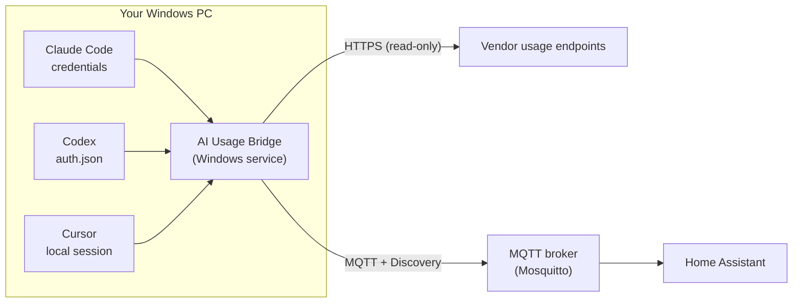

<div align="center">

# AI Usage Bridge

**See how much of your Claude, ChatGPT/Codex and Cursor plans you have left — right in Home Assistant.**

[](https://github.com/The-AI-Software-Factory/ai-usage-bridge/actions/workflows/ci.yml)
[](https://github.com/The-AI-Software-Factory/ai-usage-bridge/releases/latest)
[](LICENSE)


[English](README.md) · [Español](README.es.md)

</div>

---

If you work with several AI coding agents, each one has its own limits: a 5‑hour window, a weekly cap, an included monthly budget. Checking three dashboards before handing out the next task gets old fast.

**AI Usage Bridge** is a small Windows service that reads those numbers from the AI tools already signed in on your PC and publishes them to your MQTT broker using **Home Assistant MQTT Discovery**. The sensors show up in Home Assistant on their own, together with a **"best target"** sensor that tells you which agent has the most headroom right now.

## Contents

- [Supported services](#supported-services)
- [How it works](#how-it-works)
- [Requirements](#requirements)
- [Installation](#installation)
- [What you get in Home Assistant](#what-you-get-in-home-assistant)
- [Configuration](#configuration)
- [Updating](#updating)
- [Uninstalling](#uninstalling)
- [Troubleshooting](#troubleshooting)
- [Security and privacy](#security-and-privacy)
- [Disclaimer](#disclaimer)
- [Contributing](#contributing)
- [Building from source](#building-from-source)
- [License](#license)

## Supported services

| Service | What it reports | Session it reuses |
|---|---|---|
| **Claude** (Pro / Max) | 5‑hour and weekly usage, per‑model weekly limits, extra credits, reset times | Claude Code login |
| **ChatGPT / Codex** (ChatGPT plans that include Codex) | 5‑hour and weekly usage, reset times, credits, plan | Codex login with your ChatGPT account |
| **Cursor** (individual plans) | Included usage %, Cursor vs. other models, on‑demand spend and limit, billing cycle end | Cursor desktop app login |

You can enable any subset of them. The Claude limits are shared between claude.ai chats and Claude Code, so the numbers match the **Settings → Usage** page; the same applies to the Codex limits shown in ChatGPT's settings.

> [!NOTE]
> None of these vendors offers a public API for subscription usage. The bridge calls the same internal endpoints their own clients and dashboards use. They work today, but they can change without notice — see [Disclaimer](#disclaimer).

## How it works



1. Every few minutes the service reads the session token each tool already stores on disk. You never log in again and no extra API key is needed.
2. It asks each vendor for the current usage. It only reads; it never sends prompts or spends quota.
3. It publishes one retained JSON state per service, plus a summary, and announces all entities through MQTT Discovery.
4. If a call fails, the last good values are kept and the **Status** sensor explains why. When a reset time passes, that window drops to 0 % even before the next successful read.

## Requirements

- **Windows 10 or 11** (x64), with administrator rights to install the service. No Python installation is needed; it's bundled.
- **An MQTT broker** reachable from the PC, for example the Mosquitto add‑on in Home Assistant.
- **Home Assistant** with the [MQTT integration](https://www.home-assistant.io/integrations/mqtt/) set up and discovery enabled (the default).
- At least one of the AI tools installed and **signed in on the same PC**:
  - Claude: [Claude Code](https://docs.claude.com/en/docs/claude-code/overview), logged in with your Claude.ai account (`claude` → `/login`).
  - Codex: [Codex CLI](https://github.com/openai/codex) or the Codex app, signed in with ChatGPT (not with an API key).
  - Cursor: the [Cursor](https://cursor.com) desktop app, signed in.

## Installation

### 1. Choose your installer

Every [**release**](https://github.com/The-AI-Software-Factory/ai-usage-bridge/releases/latest) includes three equivalent packages. All of them bundle their own Python runtime, so **nothing else needs to be installed**.

| File | Best for | How it asks for the MQTT broker |
|---|---|---|
| [**`AIUsageBridge-Setup.exe`**](https://github.com/The-AI-Software-Factory/ai-usage-bridge/releases/latest/download/AIUsageBridge-Setup.exe) | Most people | A wizard page |
| [**`AIUsageBridge.msi`**](https://github.com/The-AI-Software-Factory/ai-usage-bridge/releases/latest/download/AIUsageBridge.msi) | Managed deployments (Intune, GPO, SCCM) | MSI properties, or the configuration tool at the end |
| [**`ai-usage-bridge.zip`**](https://github.com/The-AI-Software-Factory/ai-usage-bridge/releases/latest/download/ai-usage-bridge.zip) | Portable / scripted installs | Console prompts (`install.cmd`) or parameters |

Each release also publishes `SHA256SUMS.txt` to verify the downloads:

```powershell
Get-FileHash .\AIUsageBridge-Setup.exe -Algorithm SHA256
```

> [!NOTE]
> The installers aren't code‑signed yet, so Windows SmartScreen may show "Windows protected your PC". Choose **More info → Run anyway**, or build them yourself from source (see [Building from source](#building-from-source)).

### 2. Install

**Setup.exe:** run it, accept the license, enter your broker's host or IP, port (default `1883`), username and password (leave both empty for an anonymous broker), choose whether to [renew the Claude token automatically](#keeping-claude-data-fresh), and finish. When updating, the wizard shows your current settings.

**MSI:** run it and, on the last page, keep **"Configure the MQTT broker now"** checked to enter the broker details.

**Zip:** extract it and double‑click **`install.cmd`**. It asks for administrator permission and then for the broker details in a console window.

Whichever you choose, the installer:

1. Copies the app and its bundled Python to `C:\ProgramData\AIUsageBridge`.
2. Saves the broker details in `config.toml` and tests the connection.
3. Reads each AI service once and shows the result (in the console for the zip; in `logs\install.log` for the others):

   ```text
   ==> Probando lectura de Claude, Codex y Cursor
     claude  ok               margen: 87%
     codex   ok               margen: 91%
     cursor  ok               margen: 46%
     Mejor destino ahora: Codex
   ```

4. Registers and starts the **AIUsageBridge** Windows service (automatic, delayed start, restarts on failure). The service wrapper is [WinSW](https://github.com/winsw/winsw) v2.12.0, verified by its SHA‑256 hash.
5. Adds **Start menu → AI Usage Bridge → Configurar AI Usage Bridge** to change the broker later, plus a shortcut to the logs.
6. Adds **AI Usage Bridge** to *Settings → Apps → Installed apps*.

> [!TIP]
> The installers' prompts and the Home Assistant entity names are in Spanish (the project's original audience). Configuration keys and MQTT topics are language‑neutral.

#### Silent / unattended install

```powershell
# Setup.exe
.\AIUsageBridge-Setup.exe /VERYSILENT /MQTTHOST=192.168.1.10 /MQTTPORT=1883 /MQTTUSER=homeassistant /MQTTPASSWORD=your-password /CLAUDEREFRESH=1

# MSI
msiexec /i AIUsageBridge.msi /qn MQTT_HOST=192.168.1.10 MQTT_PORT=1883 MQTT_USER=homeassistant MQTT_PASSWORD=your-password CLAUDE_REFRESH=1

# Zip (from an elevated PowerShell, inside the extracted folder)
.\install.ps1 -Unattended -MqttHost 192.168.1.10 -MqttPort 1883 -MqttUser homeassistant -MqttPassword 'your-password' -ClaudeRefresh true
```

Values passed on the command line can be visible to other processes while the installer runs, so prefer the interactive mode on shared machines. If you omit the broker, the service installs and waits until you run **Configurar AI Usage Bridge**.

> [!IMPORTANT]
> The service reads the AI sessions of **the Windows user who runs the installer**. Install it from the same account where Claude Code, Codex and Cursor are signed in.

### 3. Check Home Assistant

Open **Settings → Devices & services → MQTT**. Four new devices appear within a few seconds: **AI Claude**, **AI Codex**, **AI Cursor** and **AI Resumen**.

## What you get in Home Assistant

### Per‑service sensors

| Entity | Claude | Codex | Cursor | Example `entity_id` |
|---|:-:|:-:|:-:|---|
| Uso 5h (5‑hour usage, %) | ✅ | ✅ | | `sensor.ai_claude_uso_5h` |
| Reset 5h (timestamp) | ✅ | ✅ | | `sensor.ai_codex_reset_5h` |
| Uso semanal (weekly usage, %) | ✅ | ✅ | | `sensor.ai_claude_uso_semanal` |
| Reset semanal (timestamp) | ✅ | ✅ | | `sensor.ai_codex_reset_semanal` |
| Uso semanal Opus / Sonnet (%) | ✅ | | | `sensor.ai_claude_uso_semanal_sonnet` |
| Créditos extra usados / Créditos | ✅ | ✅ | | `sensor.ai_codex_creditos` |
| Uso incluido (included usage, %) | | | ✅ | `sensor.ai_cursor_uso_incluido` |
| Uso modelos Cursor / otros modelos (%) | | | ✅ | `sensor.ai_cursor_uso_modelos_cursor` |
| On‑demand usado / límite (USD) | | | ✅ | `sensor.ai_cursor_on_demand_usado` |
| Fin de ciclo (billing cycle end) | | | ✅ | `sensor.ai_cursor_fin_de_ciclo` |
| **Margen** (headroom, %) | ✅ | ✅ | ✅ | `sensor.ai_claude_margen` |
| Estado (status, diagnostic) | ✅ | ✅ | ✅ | `sensor.ai_cursor_estado` |
| Plan, Última lectura (diagnostic) | ✅ | ✅ | ✅ | `sensor.ai_codex_plan` |

Exact entity IDs depend on your Home Assistant language and on any existing entities, so check them under the device page.

**Margen** (headroom) is what's left in the tightest window: `100 − max(5‑hour %, weekly %)` for Claude and Codex, and `100 − included %` for Cursor.

### Summary sensors (device "AI Resumen")

| Entity | Meaning |
|---|---|
| **Mejor destino** | The service with the most headroom (`Claude`, `Codex`, `Cursor`), or `Ninguno` if all are below `min_margin` |
| Margen del mejor | Headroom of that service, in % |
| Ranking | For example `Codex 91% · Claude 87% · Cursor 46%`; the attributes include every margin and status |

Use them in automations or to route work to your agents. For example, notify yourself when the best target changes:

```yaml
automation:
  - alias: "AI: best target changed"
    trigger:
      - platform: state
        entity_id: sensor.ai_resumen_mejor_destino
    action:
      - service: notify.notify
        data:
          message: "Next task → {{ states('sensor.ai_resumen_ranking') }}"
```

### MQTT topics

| Topic | Content |
|---|---|
| `ai_usage/status` | `online` / `offline` (last will) |
| `ai_usage/claude/state` | JSON state for Claude |
| `ai_usage/codex/state` | JSON state for Codex |
| `ai_usage/cursor/state` | JSON state for Cursor |
| `ai_usage/summary/state` | JSON summary |
| `homeassistant/sensor/ai_usage_*/…/config` | Discovery messages |

All messages are retained. The base topic and discovery prefix are configurable.

## Configuration

The installer writes `C:\ProgramData\AIUsageBridge\config.toml`. Only administrators and the service can read it, because it holds the MQTT password. Edit it from an elevated editor, then restart the service:

```powershell
Restart-Service AIUsageBridge
```

| Section / key | Default | Description |
|---|---|---|
| `general.log_level` | `INFO` | `DEBUG`, `INFO`, `WARNING`, `ERROR` |
| `general.min_margin` | `5` | Below this headroom (%) the best target is `Ninguno` |
| `mqtt.host`, `mqtt.port` | — , `1883` | Broker address |
| `mqtt.username`, `mqtt.password` | — | Leave empty for anonymous brokers |
| `mqtt.tls` | `false` | Use TLS (set the port accordingly, usually `8883`) |
| `mqtt.base_topic` | `ai_usage` | Root of the state topics |
| `mqtt.discovery_prefix` | `homeassistant` | Home Assistant discovery prefix |
| `<service>.enabled` | `true` | Turn `claude`, `codex` or `cursor` on or off |
| `<service>.interval_seconds` | 300 / 120 / 300 | Polling interval (Claude / Codex / Cursor) |
| `claude.credentials_path` | `%USERPROFILE%\.claude\.credentials.json` | Claude Code credentials |
| `claude.refresh_token_enabled` | `true` with the installers | Let the service renew the Claude Code token (see below) |
| `codex.auth_path` | `%USERPROFILE%\.codex\auth.json` | Codex credentials |
| `cursor.state_db` | `%APPDATA%\Cursor\User\globalStorage\state.vscdb` | Cursor local state database |
| `cursor.amounts_in_cents` | `true` | Cursor reports on‑demand amounts in cents |

### Keeping Claude data fresh

Claude usage is read with Claude Code's login, whose access token lasts a few hours. **Claude Code (terminal) only renews it when you use it.** If you mostly use Claude from the desktop app or claude.ai, the token in `.credentials.json` goes stale and the Claude status shows `token_vencido`.

That's why the installers enable **automatic renewal** by default (the *Claude* page of the Setup.exe wizard, `/CLAUDEREFRESH=1`, or `CLAUDE_REFRESH=1` in the MSI). You can turn it on or off later with **Configurar AI Usage Bridge**, or with `refresh_token_enabled` in `[claude]`.

How it works:

- The service only renews the token **after it has expired**, so it doesn't compete with an active Claude Code session.
- The new token is written back atomically to Claude Code's credentials file, keeping every other field, so Claude Code keeps working.
- If Claude Code renewed it first, the service uses that one and doesn't overwrite anything.

If the renewal is rejected (the stored refresh token was revoked or is too old), the status explains it. Open a terminal, run `claude`, then `/login` once; from then on the service keeps the token renewed.

Codex and Cursor tokens are long‑lived and are renewed by their own apps; the bridge only reads them.

## Updating

Download the new release and run it the same way (Setup.exe, MSI or zip). The service is stopped, the app is replaced, and your `config.toml` is kept. The Setup.exe wizard comes prefilled with your current broker and Claude settings; leave the password empty to keep the saved one.

To change the broker at any time, use **Start menu → AI Usage Bridge → Configurar AI Usage Bridge**.

## Uninstalling

Use *Settings → Apps → Installed apps → AI Usage Bridge → Uninstall* (or `uninstall.cmd` in the install folder). This:

- stops and removes the service,
- deletes the retained MQTT messages, so the entities disappear from Home Assistant,
- removes `C:\ProgramData\AIUsageBridge` and the Start menu shortcuts.

The AI tools and their sessions are not touched. To keep the entities in Home Assistant, run `uninstall.ps1 -KeepEntities` from an elevated PowerShell.

## Troubleshooting

Check the **Estado** (status) sensor of each service; its `error` attribute has the details.

| Status | Meaning | What to do |
|---|---|---|
| `ok` | Last read succeeded | — |
| `sin_credenciales` | The tool isn't installed or signed in on this PC, or the path is different | Sign in, or fix the path in `config.toml` |
| `token_vencido` | The stored token expired or was rejected | For Claude, see [Keeping Claude data fresh](#keeping-claude-data-fresh); for Codex or Cursor, open the app once |
| `rate_limited` | The vendor asked to slow down | Nothing; the service waits and retries. Don't lower the intervals below the defaults |
| `error` | Network error or an unexpected response | Run the diagnostics below and open an issue |

Diagnostics, from an elevated PowerShell:

```powershell
cd C:\ProgramData\AIUsageBridge
$py = ".\python\python.exe"

& $py -m ai_usage_bridge --config config.toml --test-mqtt   # broker connection
& $py -m ai_usage_bridge --config config.toml --once        # one read, prints JSON
& $py -m ai_usage_bridge --config config.toml --dump        # raw vendor responses, secrets redacted
```

Service logs are in `C:\ProgramData\AIUsageBridge\logs`.

If a vendor changed its response format, `--dump` shows the new shape. Please attach it (it's already redacted) to an [issue](https://github.com/The-AI-Software-Factory/ai-usage-bridge/issues).

## Security and privacy

- **No new credentials.** The bridge reuses the sessions already stored by Claude Code, Codex and Cursor on your PC.
- **Tokens stay local.** They're sent only to the vendor that issued them, over HTTPS. They're never published to MQTT, written to logs or included in `--dump` output.
- **Minimal writes.** The only file it writes outside its own folder is the Claude Code credentials file, and only when automatic renewal is on and the token has expired.
- **Locked‑down config.** `config.toml` is readable only by `SYSTEM` and Administrators.
- **Runs as `LocalSystem`**, the default for Windows services, so it can read your user profile files without storing your Windows password.
- MQTT is unencrypted unless you enable `tls`. Keep the broker on a trusted network.

## Disclaimer

This is an independent community project. It is **not affiliated with, endorsed by or supported by** Anthropic, OpenAI or Anysphere (Cursor). Product names are trademarks of their owners.

It relies on undocumented endpoints that may change or disappear at any time. Make sure your use complies with each service's terms. Use at your own risk.

## Contributing

Issues and pull requests are welcome, especially:

- support for more services (Gemini, GitHub Copilot, Windsurf…),
- fixes when a vendor changes its response format,
- Home Assistant dashboard examples,
- English entity names as an option.

Fork the repo, create a branch, and open a pull request against `main`. CI runs automatically on every pull request.

## Building from source

Anyone can build the three installers from their own clone or fork, including any changes they made. No permission on this repository is needed.

### On GitHub (no Windows required)

Fork the repository and enable Actions in your fork. Every push runs the [CI workflow](.github/workflows/ci.yml), which:

1. runs the tests on Linux and Windows,
2. builds `AIUsageBridge-Setup.exe`, `AIUsageBridge.msi` and `ai-usage-bridge.zip`,
3. installs and uninstalls each of them on a clean Windows runner to check that the service starts and is removed cleanly.

Download the installers from the run's **Artifacts**. Pushing a tag such as `v1.2.0` also publishes them as a GitHub release.

### On your PC

Requirements on Windows 10/11 x64:

```powershell
winget install Microsoft.PowerShell          # PowerShell 7.2+
winget install Python.Python.3.12            # used to fetch the dependencies
winget install Microsoft.DotNet.SDK.8        # needed by WiX (MSI)
```

Then, from PowerShell 7:

```powershell
git clone https://github.com/<you>/ai-usage-bridge.git
cd ai-usage-bridge
.\build\build.ps1                    # version taken from app/ai_usage_bridge/__init__.py
.\build\build.ps1 -Version 1.2.0     # or set it explicitly
.\build\build.ps1 -SkipMsi           # skip the MSI (no .NET SDK needed)
```

The script validates the PowerShell scripts, downloads the embeddable Python and WinSW (cached in `build\.cache`), installs the dependencies, tests the package, and builds everything into `dist\`. Inno Setup and WiX are installed automatically if missing.

### Project layout

```text
app/ai_usage_bridge/        Python service
  providers/                one module per AI service (fetch_raw + parse)
  publisher.py              MQTT + Home Assistant discovery
  summary.py                "best target" logic
install.ps1                 installer core, shared by the zip, Setup.exe and MSI
configure.ps1               MQTT broker configuration (Start menu shortcut)
uninstall.ps1               uninstaller
installer/setup.iss         Inno Setup script (Setup.exe)
installer/AIUsageBridge.wxs WiX script (MSI)
build/build.ps1             builds all installers
tests/                      unit tests with sample responses
```

Run the tests with:

```bash
python -m pip install -r requirements.txt pytest
python -m pytest tests
```

To add a service, create a module in `app/ai_usage_bridge/providers/` that implements `fetch_raw()` (read the local credentials and call the endpoint) and `parse()` (map the response to sensor values), register it in `providers/__init__.py`, and add tests with a sample response.

## License

[MIT](LICENSE) © The AI Software Factory
